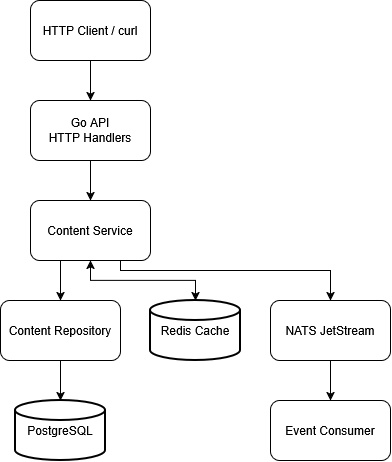

# StreamHub Architecture

## Общая структура

StreamHub реализован как модульный монолит. HTTP API, бизнес-логика и доступ к данным разделены по пакетам, но собираются в один исполняемый файл.

  

## Компоненты

### HTTP handlers

Принимают HTTP-запросы, разбирают параметры и JSON, вызывают бизнес-логику и формируют HTTP-ответы.

### Content service

Содержит бизнес-правила и валидацию. Координирует работу репозитория, кеша и издателя событий.

### Content repository

Выполняет SQL-запросы к PostgreSQL. Использует параметризованные запросы для передачи пользовательских значений.

### PostgreSQL

Основное хранилище контента. Схема создается и обновляется SQL-миграциями.

### Redis

Кеширует результаты каталога. При ошибке кеша приложение продолжает обслуживать запросы через PostgreSQL.

После операций изменения контента кеш каталога инвалидируется. При неудачной инвалидации устаревшие данные могут оставаться в кеше до истечения TTL.

### NATS JetStream

Принимает события о создании, обновлении и удалении контента. Consumer читает события и записывает информацию о них в логи.

## Поток чтения каталога

1. Клиент отправляет запрос каталога.
2. HTTP handler разбирает параметры фильтрации и пагинации.
3. Service проверяет параметры и формирует ключ кеша.
4. При наличии кешированного результата он используется.
5. При отсутствии результата данные читаются из PostgreSQL.
6. Результат сохраняется в Redis и возвращается клиенту.

## Поток изменения контента

1. Клиент отправляет запрос на создание, обновление или удаление.
2. Handler проверяет формат запроса.
3. Service выполняет валидацию.
4. Repository изменяет данные в PostgreSQL.
5. Service пытается инвалидировать кеш каталога.
6. Service пытается опубликовать событие в NATS.

## Надежность и ограничения

Запись в PostgreSQL и публикация в NATS не являются одной атомарной операцией. Поэтому возможна ситуация, когда данные сохранены, но событие не опубликовано.

Для повышения надежности в дальнейшем можно внедрить Transactional Outbox: сохранять событие в той же транзакции PostgreSQL, а отдельному процессу поручить его публикацию.

## Безопасность

Текущая версия предназначена для локальной разработки и обучения. Перед production-эксплуатацией планируется реализовать аутентификацию, авторизацию, управление секретами, ограничения запросов и настройку TLS.
